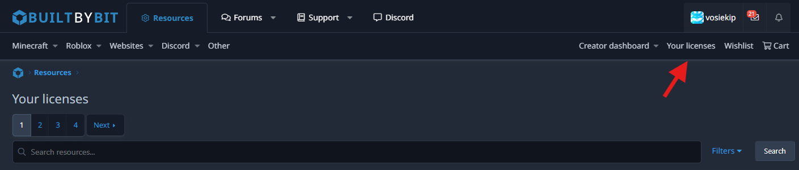
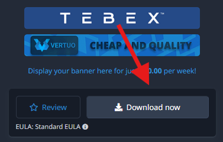

# How to download

Thank you for your purchase! This guide will walk you through the download process for your newly acquired product. You can find the licenses page [here](https://builtbybit.com/resources/market-place-user/licenses). If you’re unfamiliar with shopping on marketplaces, follow the step-by-step guide below.



### Licenses page

Navigate to the [licenses](https://builtbybit.com/resources/market-place-user/licenses) page on BuiltByBit, which is connected to your account.



### Product page

Click on the product you purchased, and press the download button at the top right of the sidebar.



Page images

Licenses page

<figure><figcaption></figcaption></figure>

Product page

<figure><figcaption></figcaption></figure>

