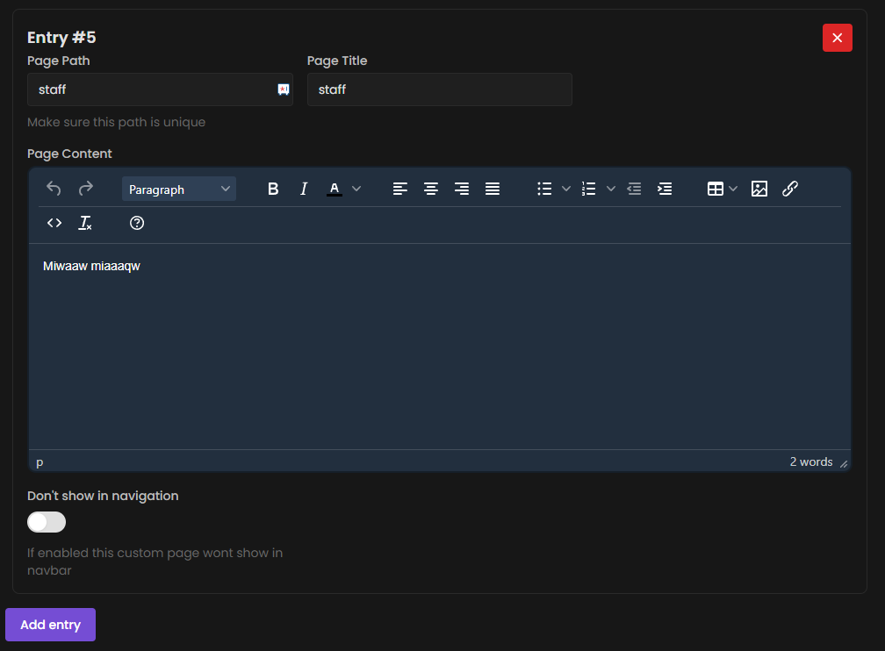
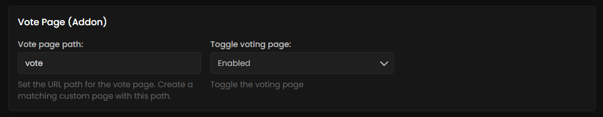
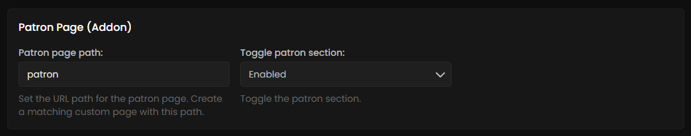

# Installation guide

Getting started with creating your first [Paynow store](https://dashboard.paynow.gg/webstore) can be challenging, but we’ll guide you through the entire process step by step to ensure everything goes smoothly. Nothing will be skipped, so you can follow along with confidence.



### Creating your Paynow project

Before we can start we need to create your first [Paynow Store](https://dashboard.paynow.gg/webstore), ensure you select the right store variant for your network.

<details>

<summary>Paynow project platforms</summary>

#### Minecraft networks

* If you are running a Minecraft network with only Java Edition players, select the "Minecraft Java Edition" option.
* If you are running a <mark style="color:$primary;">**crossplay server**</mark> (Java & Bedrock), select the "Minecraft Offline" option.

<figure><figcaption></figcaption></figure>

</details>



### Creating a Paynow template

To upload a new template you need to navigate to the appearance template creation page, which can be [found here](https://dashboard.paynow.gg/webstore/templates/create).

***

1. For support reasons we request your template name to follow a naming structure.


```
Template name [v1.0.0]
```


2. Press the create button on the bottom left.



### Opening the template editor

If you have following along you should be on the webstore template page.

* Click open Template editor at the bottom.

<figure><figcaption></figcaption></figure>



### Uploading the Webstore files

Unzip our product file and navigate to <kbd>/0. Theme</kbd> Select all files and drag them into the Paynow Template editor.

<figure><figcaption></figcaption></figure>


Make sure you select all the files in the theme directory and wait for them to upload.




### Setting up Extras

### Page Extras



The staff team page is a new html asset, essentially the same process as uploading the rest of the template files.

* Directory of the Staff-page <kbd>/0. Theme/assets/staff-page.html</kbd>

***

#### **How to upload**

* Select the html file and drag it into the editor.

#### Staff team setup

* Create a Custom page entry in your template settings.
* Go to the Staff Team Page (Addon) in template settings.
* Enter your page Tile (Case sensitive) in "Staff page title" setting.

<figure><figcaption></figcaption></figure>

<figure><figcaption></figcaption></figure>

***

#### Staff team settings

* Enter your staff team role labels (Example: Owners, Administrator, Moderators, Helpers, Media)
* Enter your staff usernames for each role "Owner #1, Administrator #1, etc"



The vote page is a new html asset, essentially the same process as uploading the rest of the template files.

* Directory of the Vote-page <kbd>/0. Theme/assets/vote-page.html</kbd>

***

#### **How to upload**

* Select the html file and drag it into the editor.

#### Vote setup

* Create a Custom page entry in your template settings.
* Go to the Vote Page (Addon) in template settings.
* Enter your page Tile (Case sensitive) in "Vote page title" setting.

<figure><figcaption></figcaption></figure>

<figure><figcaption></figcaption></figure>

***

#### Vote settings

* Enter the vote title and vote link for each vote site.\
  _(Title in "Vote Button 1 Text:" link in "Vote Button 1 Link")_



The Patron page is a new html asset, essentially the same process as uploading the rest of the template files.

* Directory of the patron page <kbd>/0. Theme/assets/patron.html</kbd>

***

#### **How to upload**

* Select the html file and drag it into the editor.

#### Patron setup

* Create a Custom page entry in your template settings.
* Go to the Patron Page (Addon) in template settings.
* Enter your page Tile (Case sensitive) in "Patron page title" setting.

<figure><figcaption></figcaption></figure>

<figure><figcaption></figcaption></figure>

***

#### Patron settings

* Enter your patron tiers (Example: Diamond, Emerald, Netherite)
* Enter your patron players usernames for their achieved tier.

<figure><figcaption></figcaption></figure>



The Faq & rules is a new html asset, essentially the same process as uploading the rest of the template files.

* Directory of the Faq-page <kbd>/0. Theme/assets/faq-page.html</kbd>
* Directory of the Rules-page <kbd>/0. Theme/assets/rules-page.html</kbd>

***

#### **How to upload**

* Select the html files and drag it into the editor.

#### Rules & Faq setup

* Create a Custom page entry in your template settings.
* Go to the Faq & Rules Page (Addon) in template settings.
* Enter your page Tile (Case sensitive) in "Faq or Rules page title" setting.

<figure><figcaption></figcaption></figure>

<figure><figcaption></figcaption></figure>

***

#### Faq & Rules settings

* Enter the FAQ or Rules title and Description link for each FAQ or Server rule.\
  _(Title in "_&#x46;AQ #1 Questio&#x6E;_" link in "_&#x46;AQ #1 Answe&#x72;_")_



### Category Extras



The staff team page is a new html asset, essentially the same process as uploading the rest of the template files.

* Directory of the Rank table <kbd>/0. Theme/assets/ranktable.html</kbd>

***

#### **How to upload**

* Select the html file and drag it into the editor.

#### Rank table setup

* Copy your ranks category TAG: [https://dashboard.paynow.gg/tags](https://dashboard.paynow.gg/tags).
* Go to the template editor Rank category (Addon).
* Enter your category TAG in "TAG of your rank category" setting.

<figure><figcaption></figcaption></figure>

***

#### Rank table code

* The Rank table is unique for all themes and is edited within the Ranktable.html file itself. Open the file with [https://code.visualstudio.com/](https://code.visualstudio.com/) and follow the steps within the file.



The upsell & coin slider is a new html asset, essentially the same process as uploading the rest of the template files.

* Directory of the Upsell <kbd>/0. Theme/assets/upsell.html</kbd>
* Directory of the Coin slider <kbd>/0. Theme/assets/coin-slider.html</kbd>

***

#### **How to upload**

* Select the html file and drag it into the editor.

#### Upsell setup

* Copy your parent package ID: [https://creator.tebex.io/packages](https://creator.tebex.io/packages). (Key x1)
* Go to the [https://creator.tebex.io/appearance](https://creator.tebex.io/appearance) Package Upselling (Addon)
* Enter your <mark style="color:$primary;">parent package ID</mark> in "Crate 1 - Parent Package ID" setting.
* Enter the Crate 1 - Upsell Package IDs in order separated by "," Example: <mark style="color:$primary;">**470603945287360512**</mark>,<mark style="color:$warning;">00000000000000000</mark>,<mark style="color:blue;">00000000000000000</mark>,<mark style="color:pink;">00000000000000000</mark>

<figure><figcaption></figcaption></figure>

***

#### Coin slider Setup

Coin sliders works essentialy the same as the key upselling only diffrence are the display name and stage labels.

* Display name is the name of your coin Example: "Gems"
* Stage labels, are the Gem amounts.


**Why stage labels and titles?**\
\
We are not fetching the package names as these often include the amount and the title making the names to long for the coin slider tiers.




The Gift cards category is a new html asset, essentially the same process as uploading the rest of the template files.

* Directory of the Gift cards <kbd>/0. Theme/assets/giftcard.html</kbd>

***

#### **How to upload**

* Select the html file and drag it into the editor.

#### Gift cards setup

* Copy your gift cards category TAG: [https://dashboard.paynow.gg/tags](https://dashboard.paynow.gg/tags).
* Go to the template editor Rank category (Addon).
* Enter your category TAG in "TAG of your gift card category" setting.

<figure><figcaption></figcaption></figure>


Giftcards category needs a total of Five giftcards package types to match the preview.





