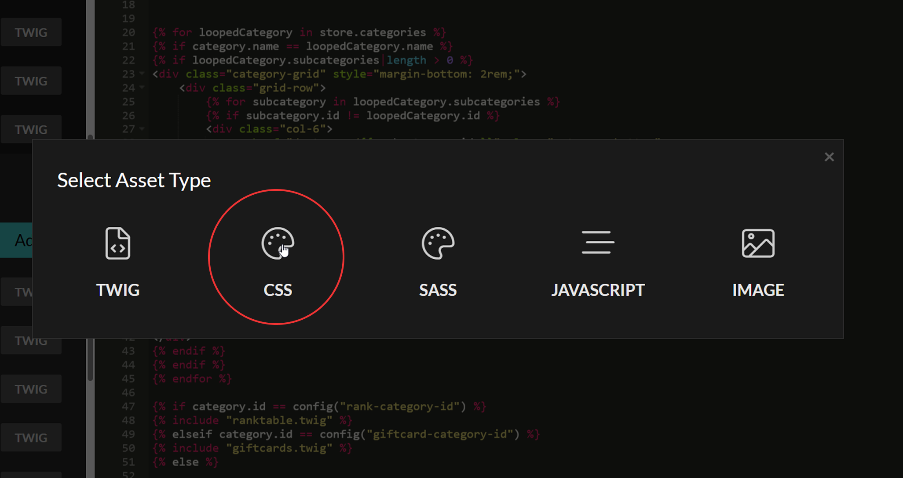
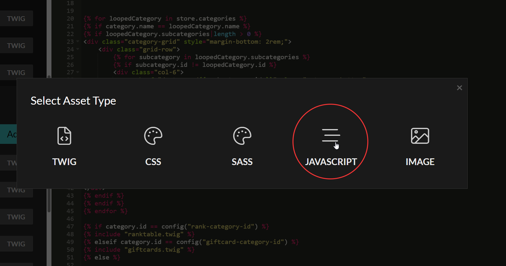
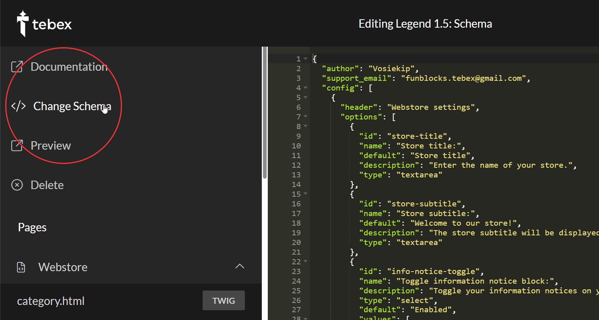

# Installation guide

Getting started with creating your first [Tebex store](https://creator.tebex.io/get-started) can be challenging, but we’ll guide you through the entire process step by step to ensure everything goes smoothly. Nothing will be skipped, so you can follow along with confidence.

Prefer a visual approach? You can also explore our [video documentation →](video-docs.md) here for help with installing and setting up theme settings and add-ons.



### Creating your Tebex project

Before we can start we need to create your first [Tebex project](https://creator.tebex.io/creator-segments#/), ensure you select the right store variant for your network.

<details>

<summary>Tebex project platforms</summary>

#### Minecraft networks

* If you are running a Minecraft network with only Java Edition players, select the "Minecraft Java Edition" option.
* If you are running a <mark style="color:$primary;">**crossplay server**</mark> (Java & Bedrock), select the "Minecraft Offline" option.

<figure><figcaption></figcaption></figure>

</details>



### Creating a Tebex template

To upload a new template you need to navigate to the appearance template creation page, which can be [found here](https://creator.tebex.io/templates/create).&#x20;

***

1. For support reasons we request your template name to follow a naming structure.&#x20;


```
Template name [v1.0.0]
```


2. Press the create button on the bottom left.



### Opening the template editor

If you have following along you should already inside of the template editor.



If you see the following, you are on the editor and you can move to next step.&#x20;

<figure><figcaption></figcaption></figure>



Getting to the editor is quite easy follow these steps carefully.&#x20;

1. Navigate to the projects [appearance page](https://creator.tebex.io/appearance).
2. Press the "launch Editor" button, which is located in the center of your screen.

<figure><figcaption></figcaption></figure>





### Uploading the Webstore files

Let’s replace the default HTML files with our custom versions. The file names in the editor match those in the downloaded template, making it easy to identify which files to update.&#x20;

<details>

<summary>How to upload webstore files</summary>

Use keyboard shortcuts to copy our files and minimize the risk of errors:

* Copy the new file content: <mark style="color:$primary;">**Ctrl + A**</mark>, then <mark style="color:$primary;">**Ctrl + C**</mark>
* Paste and overwrite the existing code: <mark style="color:$primary;">**Ctrl + A**</mark>, then <mark style="color:$primary;">**Ctrl + V**</mark>
* Save your changes: <mark style="color:$primary;">**Ctrl + S**</mark>


Make sure to save each file before moving on to the next. If you don’t, the default code will remain, which may cause the theme to not function correctly after publishing.


</details>

Make sure you’re using a code editor to open the template files, such as [Visual Studio Code](https://code.visualstudio.com/download)



### Uploading Assets

We have a few assets to upload, follow this process precisely or else the styling, function, header and footer won't function. Making the entire process fail.&#x20;



* Press the "Add" button below the Assets section of the template editor. The assets section is located below the webstore section.&#x20;
* Select the **CSS** variable and locate the Store.css from the download <kbd>/0. Theme/assets-files/store.css</kbd>

<figure><figcaption></figcaption></figure>





* Press the "Add" button below the Assets section of the template editor. The assets section is located below the webstore section.&#x20;
* Select the **JAVASCRIPT** variable and locate the Store.css from the download <kbd>/0. Theme/assets-files/function.js</kbd>

<figure><figcaption></figcaption></figure>



The footer is copy and pasted over the existing Footer.twig, essentially the same process as uploading the webstore files.&#x20;

* Directory of the Footer.twig <kbd>/0. Theme/assets-files/other/footer.twig</kbd>

***

Use keyboard shortcuts to copy our files and minimize the risk of errors:

* Copy the new file content: <mark style="color:$primary;">**Ctrl + A**</mark>, then <mark style="color:$primary;">**Ctrl + C**</mark>
* Paste and overwrite the existing code: <mark style="color:$primary;">**Ctrl + A**</mark>, then <mark style="color:$primary;">**Ctrl + V**</mark>
* Save your changes: <mark style="color:$primary;">**Ctrl + S**</mark>


Make sure to save each file before moving on to the next. If you don’t, the default code will remain, which may cause the theme to not function correctly after publishing.




The header is copy and pasted over the existing Header.twig, essentially the same process as uploading the webstore files.&#x20;

* Directory of the Header.twig <kbd>/0. Theme/assets-files/other/header.twig</kbd>

***

Use keyboard shortcuts to copy our files and minimize the risk of errors:

* Copy the new file content: <mark style="color:$primary;">**Ctrl + A**</mark>, then <mark style="color:$primary;">**Ctrl + C**</mark>
* Paste and overwrite the existing code: <mark style="color:$primary;">**Ctrl + A**</mark>, then <mark style="color:$primary;">**Ctrl + V**</mark>
* Save your changes: <mark style="color:$primary;">**Ctrl + S**</mark>


Make sure to save each file before moving on to the next. If you don’t, the default code will remain, which may cause the theme to not function correctly after publishing.






### Uploading the Schema

The schema controls the theme settings, therefor being one of the most essential files to upload and its often overlooked. <br>

* Navigate the to the top of the template editor, and press <mark style="color:$primary;">**"\</> Change schema"**</mark>.
* Directory of the Schema <kbd>/0. Theme/Schema-files/dark-schema.twig</kbd>

<details>

<summary>How to upload the schema file</summary>

Use keyboard shortcuts to copy our files and minimize the risk of errors:

* Copy the new file content: <mark style="color:$primary;">**Ctrl + A**</mark>, then <mark style="color:$primary;">**Ctrl + C**</mark>
* Paste and overwrite the existing code: <mark style="color:$primary;">**Ctrl + A**</mark>, then <mark style="color:$primary;">**Ctrl + V**</mark>
* Save your changes: <mark style="color:$primary;">**Ctrl + S**</mark>

<figure><figcaption></figcaption></figure>


Make sure to save each file before moving on to the next. If you don’t, the default code will remain, which may cause the theme to not function correctly after publishing.


</details>



### Setting up Extras

### Page Extras



The staff team page is a new twig asset, essentially the same process as uploading the store.css but now for the twig variable.&#x20;

* Directory of the Staff-page <kbd>/0. Theme/assets/staff-page.twig</kbd>

***

#### **How to upload**

* Press the "Add" button below the Assets section of the template editor. The assets section is located below the webstore section.&#x20;
* Select the **TWIG** variable and locate the staff-page.twig from the download.


Make sure you select upload so the file name matches with the code input variables.


#### Staff team setup

* Create a Tebex page here: [https://creator.tebex.io/pages](https://creator.tebex.io/pages).
* Go to the [https://creator.tebex.io/appearance](https://creator.tebex.io/appearance) Staff Team Page (Addon)
* Enter your page Tile (Case sensitive) in "Staff page title" setting.

<figure><figcaption></figcaption></figure>

***

#### Staff team settings

* Enter your staff team role labels (Example: Owners, Administrator, Moderators, Helpers, Media)
* Enter your staff usernames for each role "Owner #1, Administrator #1, etc"

<figure><figcaption></figcaption></figure>





The vote page is a new twig asset, essentially the same process as uploading the store.css but now for the twig variable.&#x20;

* Directory of the Vote-page <kbd>/0. Theme/assets/vote-page.twig</kbd>

***

#### **How to upload**

* Press the "Add" button below the Assets section of the template editor. The assets section is located below the webstore section.&#x20;
* Select the **TWIG** variable and locate the vote-page.twig from the download.


Make sure you select upload so the file name matches with the code input variables.


#### Vote setup

* Create a Tebex page here: [https://creator.tebex.io/pages](https://creator.tebex.io/pages). x1
* Go to the [https://creator.tebex.io/appearance](https://creator.tebex.io/appearance) Vote Page (Addon)
* Enter your page Tile (Case sensitive) in "Vote page title" setting.

<figure><figcaption></figcaption></figure>

***

#### Vote settings

* Enter the vote title and vote link for each vote site.\
  _(Title in "Vote Button 1 Text:" link in "Vote Button 1 Link")_

<figure><figcaption></figcaption></figure>





The Patron page is a new twig asset, essentially the same process as uploading the store.css but now for the twig variable.&#x20;

* Directory of the patron page <kbd>/0. Theme/assets/patron.twig</kbd>

***

#### **How to upload**

* Press the "Add" button below the Assets section of the template editor. The assets section is located below the webstore section.&#x20;
* Select the **TWIG** variable and locate the patron.twig from the download.


Make sure you select upload so the file name matches with the code input variables.


#### Patron setup

* Create a Tebex page here: [https://creator.tebex.io/pages](https://creator.tebex.io/pages). x1
* Go to the [https://creator.tebex.io/appearance](https://creator.tebex.io/appearance) Patron Page (Addon)
* Enter your page Tile (Case sensitive) in "Patron page title" setting.

<figure><figcaption></figcaption></figure>

***

#### Patron settings

* Enter your patron tiers (Example: Diamond, Emerald, Netherite)
* Enter your patron players usernames for their achieved tier.

<figure><figcaption></figcaption></figure>





The Faq & Rules page is a new twig asset, essentially the same process as uploading the store.css but now for the twig variable.&#x20;

* Directory of the Faq-page <kbd>/0. Theme/assets/faq-page.twig</kbd>&#x20;
* Directory of the Rules-page <kbd>/0. Theme/assets/rules-page.twig</kbd>

***

#### **How to upload**

* Press the "Add" button below the Assets section of the template editor. The assets section is located below the webstore section.&#x20;
* Select the **TWIG** variable and locate the faq-page.twig from the download.
* Select the **TWIG** variable and locate the rules-page.twig from the download.


Make sure you select upload so the file name matches with the code input variables.


#### Rules & Faq setup

* Create a Tebex page here: [https://creator.tebex.io/pages](https://creator.tebex.io/pages). x2
* Go to the [https://creator.tebex.io/appearance](https://creator.tebex.io/appearance) Faq Page & Rules page (Addon)
* Enter your page Tile (Case sensitive) in "Faq page title" setting.
* Enter your page Tile (Case sensitive) in "Rules page title" setting.

<figure><figcaption></figcaption></figure>

***

#### Faq & Rules settings

* Enter the FAQ or Rules title and Description link for each FAQ or Server rule.\
  _(Title in "_&#x46;AQ #1 Questio&#x6E;_" link in "_&#x46;AQ #1 Answe&#x72;_")_

<figure><figcaption></figcaption></figure>



### Category Extras



The Rank table category is a new twig asset, essentially the same process as uploading the store.css but now for the twig variable.&#x20;

* Directory of the Rank table <kbd>/0. Theme/assets/ranktable.twig</kbd>

***

#### **How to upload**

* Press the "Add" button below the Assets section of the template editor. The assets section is located below the webstore section.&#x20;
* Select the **TWIG** variable and locate the Ranktable.twig from the download.


Make sure you select upload so the file name matches with the code input variables.


#### Rank table setup

* Copy your ranks category ID: [https://creator.tebex.io/packages](https://creator.tebex.io/packages).
* Go to the [https://creator.tebex.io/appearance](https://creator.tebex.io/appearance) Rank category (Addon).
* Enter your category ID in "ID of your rank category" setting.

<figure><figcaption></figcaption></figure>

***

#### Rank table code

* The Ranktable is unique for all themes and is edited within the Ranktable.twig file itself. Open the file with [https://code.visualstudio.com/](https://code.visualstudio.com/) and follow the steps within the file.



The Upsell & Coinslider are new twig assets, essentially the same process as uploading the store.css but now for the twig variable.&#x20;

* Directory of the Upsell <kbd>/0. Theme/assets/upsell.twig</kbd>&#x20;
* Directory of the Coin slider <kbd>/0. Theme/assets/coin-slider.twig</kbd>

***

#### **How to upload**

* Press the "Add" button below the Assets section of the template editor. The assets section is located below the webstore section.&#x20;
* Select the **TWIG** variable and locate the Upsell.twig from the download.
* Select the **TWIG** variable and locate the Coin-slider.twig from the download.


Make sure you select upload so the file name matches with the code input variables.


#### Upsell setup

* Copy your parent package ID: [https://creator.tebex.io/packages](https://creator.tebex.io/packages). (Key x1)
* Go to the [https://creator.tebex.io/appearance](https://creator.tebex.io/appearance) Package Upselling (Addon)
* Enter your <mark style="color:$primary;">parent package ID</mark> in "Crate 1 - Parent Package ID" setting.
* Enter the Crate 1 - Upsell Package IDs in order separated by "," Example: <mark style="color:$primary;">**7170425**</mark>,<mark style="color:$warning;">000000</mark>,<mark style="color:blue;">000000</mark>,<mark style="color:pink;">000000</mark>.

<figure><figcaption></figcaption></figure>

<figure><figcaption></figcaption></figure>

***

#### Coin slider Setup

Coin sliders works essentialy the same as the key upselling only diffrence are the display name and stage labels.

* Display name is the name of your coin Example: "Gems"
* Stage labels, are the Gem amounts.&#x20;


**Why stage labels and titles?** \
\
We are not fetching the package names as these often include the amount and the title making the names to long for the coinslider tiers.




The Gift cards category is a new twig asset, essentially the same process as uploading the store.css but now for the twig variable.&#x20;

* Directory of the Gift cards <kbd>/0. Theme/assets/giftcard.twig</kbd>

***

#### **How to upload**

* Press the "Add" button below the Assets section of the template editor. The assets section is located below the webstore section.&#x20;
* Select the **TWIG** variable and locate the Giftcards.twig from the download.


Make sure you select upload so the file name matches with the code input variables.


#### Gift cards setup

* Copy your ranks category ID: [https://creator.tebex.io/packages](https://creator.tebex.io/packages).
* Go to the [https://creator.tebex.io/appearance](https://creator.tebex.io/appearance) Gift Card (Addon).
* Enter your category ID in "ID of your giftcard category:" setting.

<figure><figcaption></figcaption></figure>


Giftcards category needs a total of Five giftcards package types to match the preview.





