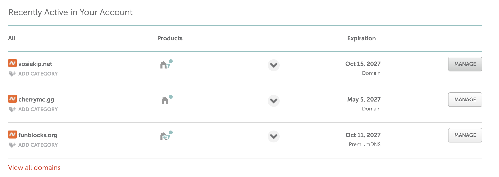
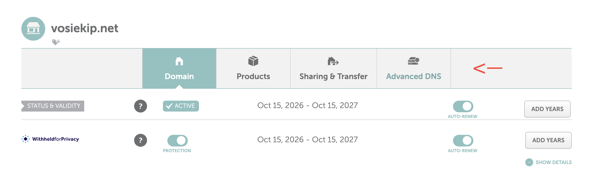
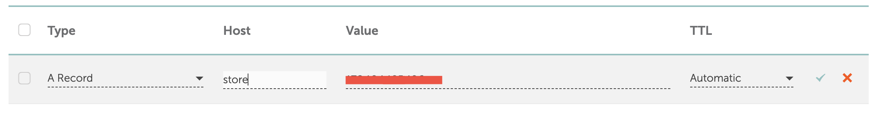

# Setting up your domain

Your store needs its own address, such as `mystore.com` or `store.mynetwork.com`. That address is called a **domain**. In this guide we register one at [Namecheap](https://www.namecheap.com/), point it to your hosting with an **A record**, and link it to your hosting.


**Already own a domain?** Skip to [Finding your IP address](#finding-your-ip-address). Your domain doesn't have to be at Namecheap, every domain provider has the same DNS settings under slightly different names.


### How does a domain reach your store?

Two things have to be set up, and this guide covers both:

| Where             | What you set up      | What it does |
| ----------------- | -------------------- | ------------ |
| **1. Namecheap**  | An **A record**      | Sends visitors of `store.mynetwork.com` to your hosting's **IP address**. Think of it as the street address of your hosting. |
| **2. Your hosting** | The **domain** on your hosting | Tells your hosting which website to show when a visitor arrives for `store.mynetwork.com`. |

```
Visitor types store.mynetwork.com
        ↓  1. A record at Namecheap
Your hosting (IP address 123.45.67.89)
        ↓  2. Domain added on your hosting
Your Tebex website
```

If only step 1 is done, visitors reach your hosting, but your hosting doesn't know what to show them and you get an error page.

<details>

<summary>Domain or subdomain, what's the difference?</summary>

* **Domain:** `mynetwork.com`. You buy this once a year.
* **Subdomain:** `store.mynetwork.com`. A free extra address on a domain you already own. Great if your network's website already runs on `mynetwork.com`.

Both work for your store. Pick a subdomain if you already have a domain for your network, so you don't have to buy a new one.

</details>

***



### Registering your domain

1. Go to [namecheap.com](https://www.namecheap.com/) and type the name you want in the search bar, for example `mynetwork`.
2. Pick an available domain from the list, `.com` and `.net` are the most common. Press <mark style="color:$primary;">**Add to cart**</mark>.
3. Press <mark style="color:$primary;">**Checkout**</mark>. Leave **Domain Privacy** on, it hides your name and address from the public, and it's free.
4. Create a Namecheap account and complete the payment.


Check the **renewal price** before you buy. Some domains are very cheap for the first year and much more expensive after that.




### Finding your IP address

The A record sends visitors of your domain to your hosting. For that you need your hosting's **IP address**, a number like `123.45.67.89`.



1. Log in to **cPanel**.
2. Look at the **General Information** box on the right side of the page.
3. Copy the number next to <mark style="color:$primary;">**Shared IP Address**</mark>.

Can't find it? Your hosting's welcome email usually lists it too, or ask your host's support.



Your server's IP address is in the welcome email from your VPS provider, and in their dashboard next to your server.





### Adding the A record

1. Log in to Namecheap. Your domains are listed on the dashboard, or under <mark style="color:$primary;">**Domain List**</mark> in the menu on the left.
2. Press <mark style="color:$primary;">**Manage**</mark> next to your domain.

<figure><figcaption></figcaption></figure>

3. Open the <mark style="color:$primary;">**Advanced DNS**</mark> tab.

<figure><figcaption></figcaption></figure>

4. Under **Host Records**, press <mark style="color:$primary;">**Add New Record**</mark> and choose **A Record**.
5. Fill in the three fields:
   * **Host:** the part of the address in front of your domain. Look up your store address in the table below.
   * **Value:** your IP address from the previous step, for example `123.45.67.89`.
   * **TTL:** leave it on `Automatic`.

| If your store address is… | …type this in **Host** |
| ------------------------- | ---------------------- |
| `store.mynetwork.com`     | `store`                |
| `shop.mynetwork.com`      | `shop`                 |
| `mynetwork.com` (no subdomain) | `@`               |


Need more than one subdomain, for example `store` and `demo`? Add one A record for each, with the same IP address in **Value**.


6. Press the green ✔ to save.

<figure><figcaption><p>Example for <code>store.mynetwork.com</code>: Host <code>store</code>, Value your IP address, TTL <code>Automatic</code>.</p></figcaption></figure>

<details>

<summary>I don't see Host Records</summary>

Your domain uses other nameservers. Open the **Domain** tab, set **Nameservers** to <mark style="color:$primary;">**Namecheap BasicDNS**</mark>, press the green ✔, and go back to **Advanced DNS**.

</details>

<details>

<summary>There are already records for @ and www</summary>

New Namecheap domains come with two "parking page" records: a **URL Redirect Record** for `@` and a **CNAME Record** for `www` that points to `parkingpage.namecheap.com`.

* Using a **subdomain** (like `store`)? Leave them, they don't get in the way.
* Using the **domain itself** (`@`)? Delete both with the bin icon, then add your A record.

</details>



### Adding the domain to your hosting

This is part **2** from the top of this page: your hosting has to know your domain, so it knows to show your store when a visitor arrives.



Your domain must be added in cPanel, otherwise it won't show up in the **Application URL** list when you create the Node.js app.

* **Is it the main domain** you chose when ordering your hosting? Then it's already added, you can skip this step.
* **Is it a different domain or a subdomain?** Add it in cPanel:

1. Open <mark style="color:$primary;">**Domains → Domains**</mark> in cPanel and press <mark style="color:$primary;">**Create A New Domain**</mark>.
2. Type your domain or subdomain, for example `store.mynetwork.com`.
3. Untick **Share document root**, then press <mark style="color:$primary;">**Submit**</mark>.

After that, the [Hosting panel install](hosting-panel-install.md) links the domain to your store when you pick it as the **Application URL** of the Node.js app.



There is nothing to do here yet. In the [VPS install](vps-install.md) you put your domain in the nginx file (`server_name store.example.com;`). That line is what tells your server to show your store for this domain.





### Waiting for DNS

DNS changes take a while to spread across the internet, usually a few minutes and sometimes up to a few hours.

You can check it at [dnschecker.org](https://dnschecker.org/): type your domain, pick **A**, and press **Search**. When most locations show a green tick and your IP address, your domain is ready.


You can continue with the installation in the meantime. You only need the domain working when you **turn on SSL**.




***

Domain ready? Continue with your installation guide: [Hosting panel install](hosting-panel-install.md) or [VPS install](vps-install.md).
